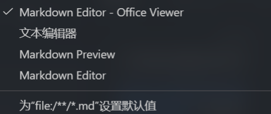

## 一、开篇介绍
MarkDown语法兼容HTML、CSS语言。
Markdown是轻量级标记语言，纯文本编写，易读易写，可以转 HTML；GitHub、笔记软件、博客都支持。区分**标准 Markdown**和**扩展语法**（不同编辑器 / 平台支持有差异，GitHub、VSCode 支持大部分扩展）。

## 二、块级语法（独立成行、占一整个区块）
1. **标题**：`# 一级标题`，最多 6 个`######`六级标题，`#`后面必须空格
    # 一级标题 
    ## 二级标题
    ### 三级标题
    #### 四级标题
    ##### 五级标题
    ###### 六级标题
2. **引用块**：`> 引用内容`，多层嵌套 `>>`
    > 引用内容
    >> 多层嵌套
3. **列表**
   - 无序列表：`-` / `*` / `+` + 空格
   1. 有序列表：`1. 内容`，数字自动递增
   - [ ] 任务列表：`- [ ] 未完成`
   - [x] 任务列表：`- [x] 已完成`
4. **分割线**：三个及以上 `-` 或者 `*`，`---`
---
5. **代码块**：三个反引号 `，后面可以标注语言（python）开启语法高亮
```cpp
int main() {
    cout << "Hello World!";
    return 0;
}
```
6. **表格**：`|表头|表头|`，第二行`|---|:---:|`控制对齐（左对齐、居中、右对齐）
|姓名|年龄|成绩|
|:---|---:|:---:|
|小明|20|90|
|小张|21|95|
7. **脚注**：正文`[^标记]`，文末`[^标记]: 注释内容`
什么是少炮[^少炮]
[^少炮]: 少炮指炮数少。
8. **块级数学公式**：`$$ 公式 $$`，LaTeX 语法
$$
\frac{\partial  f}{\partial  x}=2\sqrt{a}x
$$

## 三、行内语法（写在一行文字中间）
1. **加粗**：`**文字**`
**文字**
2. **斜体**：`*文字*`
*文字*
3. **加粗斜体**：`***文字***`
***文字***
4. **行内代码**：``代码``
`代码`
5. **链接**：`[显示文字](链接地址 "可选标题")`
[百度](baidu.com "搜索引擎 点击跳转")
[回到标题](#一级标题)
**URL**:
https://www.baidu.com
**引用链接**:
[淘宝][taobao]，[淘宝][taobao]，[淘宝][taobao]

[taobao]: https://taobao.com "搜索引擎 点击跳转"
6. **图片**：``

7. **行内公式**：`$公式$`
$\theta=x^2$
8. **高亮**：`==文字==`（扩展语法，标准 md 没有）
==文字==
9. **上标、下标**：依靠 HTML `<sup>上标</sup>`、`<sub>下标</sub>`
E=mc<sup>2</sup>，CO<sub>2</sub>
10. **表情**：`:emoji名字:` 例如`:smile:`
:smile:
11. **下划线**：依靠 HTML `<u>文字</u>`
<u>文字</u>
12. **视频**: 使用bilibili网页版的嵌入代码
<iframe src="//player.bilibili.com/player.html?isOutside=true&aid=117576105531486&bvid=BV1T74p65E33&cid=43416685405&p=1" scrolling="no" border="0" frameborder="no" framespacing="0" allowfullscreen="true"></iframe>

## 四、重点提醒（视频里的坑）
1. 换行：单纯回车不换行；**两个空格再回车** 才是软换行；空一行代表新段落
2. 兼容性：一部分语法是扩展语法（高亮、下标、脚注、任务框），有些平台不支持，GitHub 支持度很好
3. 转义：符号`# * [] ()`想要原样显示，前面加反斜杠`\`
4. 编辑器推荐：StackEdit（视频演示用）、VSCode、Typora、Obsidian

## 五、结尾

8 分钟只覆盖高频常用语法，足够写文档、笔记、GitHub 仓库 README；复杂排版可以混用少量 HTML 标签。

---

### 精简版（适合贴进你的残篇.md 里）

```
# Markdown速查
> 视频：BV1JA411h7Gw
## 块级
# 标题 | >引用 | -列表 | 1.有序 | ---分割线
```语言 代码块``` | 表格 | [^脚注] | $$公式$$
## 行内
**加粗** *斜体* `行内代码` [文字](url)  $行内公式$
==高亮== ^上标^ ~下标~ <u>下划线</u> :emoji:
## 注意
末尾两空格=换行；空行=新段落；\ 转义符号；部分语法属于扩展，平台兼容有区别
```
