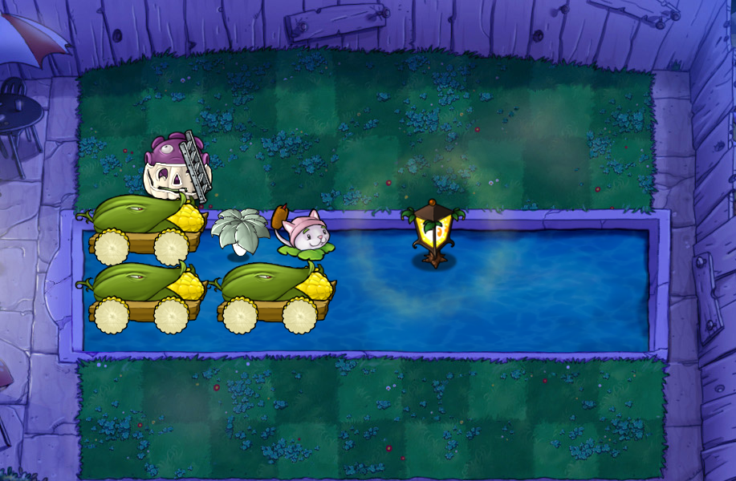

# 《残篇》

**可下一个十年，就不是炙热的二十几岁了**

写在前面：

1. 以下内容篇幅较长、分析尽可能详细，不可避免包含部分**主观看法**，在此声明均为**个人观点**；如有明显错误、漏洞疏忽或是相异观点，欢迎在评论区指出；如造成不适纯无意之举。
2. 本文结构层次序数遵循国标 GB/T 9704：**一、 →（一）→ 1. →（1）**。
3. 行文尽量简练，通用名词、易理解术语不再额外解释。阅读前建议先熟悉少炮相关内容；**如果大部分名词、机制都看不懂，请勿在评论逐条提问**，可以先阅读相关资料：**《手动少炮定级贴》**、**新旧版《少炮通论》**等。
4. 在3.以及下文中提到的<u>少炮</u>，主要指代**夜间、低/无io、低参、极限少炮**，是我主要研究游玩的方向，本文不参与相关名词定义的争议。
5. 本文主要使用第八代轨道节奏新命名，部分新旧命名同时给出。

---

## 一、少炮是什么

1. 什么是==少炮==: 炮数少。
2. 什么是==少炮阵型==: 炮数少的炮阵。
3. 少炮，特别是**极限少炮**[^极限少炮]都是围绕炮数少所展开的。
   炮数少意味着缺少运算量，为了凑足激活运算和减小压力，**低参数**成了必然。
   低参数往往与**循环轨道**绑定，炮数过少时，每个运算的时机往往固定，不利于逐波规划，后场曾覆盖或放空的情况除外。
4. 在不变炮数的前提下应对的方法包括**提高复用率**、**提高实际效率**、**减小压力**。

> 提高复用率：拉长波长，合理排布运算。
> 提高实际效率：合理排布，一炮多用。
> 减小压力：拉长波长，时空兑换，垫材拖延，减速黄油拖延，增加io。

* <u>拉长波长</u>：作用：增加循环内最多复用出的运算总量，同时减慢僵尸的刷新速度减小僵尸压力。
方法：分离炮、时空兑换、垫材拖延、减速线等都是在不激活刷新的前提下延后僵尸威胁植物、进家的时间从而拉长波长。
* <u>合理排布运算</u>：排布方法参考“循环铲种”一文。
* <u>一炮多用</u>：提高炮使用效率最直接的方法，如无冰分离，一炮解决了矿工跳跳扶梯冰车橄榄小丑等快速且可压制前场上波巨人。
* <u>时空兑换</u>：通过放空场地来延迟处理僵尸的时间从而减小压力。
* <u>垫材拖延</u>：拖延僵尸前进，本质上同样是延后处理僵尸的时间从而减小压力。
* <u>减速黄油拖延</u>：双冰变奏、冰瓜减速线、黄油定身，拖延僵尸前进，减小僵尸压力。
* <u>增加io</u>：后场曾处理矿跳梯鬼，车丑橄巨抗模型，减小僵尸压力。

---

## 二、如何分析少炮

初学者看到一个新的少炮阵型，通常会没有头绪，应该怎么分析？而老玩家一眼就能看出什么节奏能解，甚至直接写出具体轨道，而且往往是正确的，他们是怎么做到的？或者说怎么分析是高效的。

笔者认为，主要从<u>三个角度</u>出发分析，这三个角度简单说就是：**经验**。

### （一）阵型、构型

高手们见过打过各种各样的阵型，一眼就能与脑海中的数据库对应上，因此可以马上说出阵解，俗称经验之谈。这是最高效的，对于初学者来说也是不容易实现的，但是这个方法在面对新构型时，效果会大打折扣。

1. 低级一点的是，找相同的阵型，通俗来说就是**套阵解**
   （1）比如：FE雨夜孤灯和FE纯三炮，N4:I-B-JPA|I-B-Nd，本质完全相同。
2. 高级一点的是，提炼**一类构型的最优解法**
   特定的构型为了守护植物，在特定时间点之前必须要消灭特定的僵尸，本质上也是套解，但是需要考虑复用问题，合理分配运算的生效时机。
   （1）比如：上半场都是守56列的一类构型，激活时快速僵尸会啃，需要提前强分离；无垫消灭巨人，需要在下波分离前伤四次；完全激活的前提下，那么解就是N4:I-BS-PS|I-BS-PS或I-B-PSS|I-B-PSS或I-BSS-P|I-BSS-P，具体采用哪一个需要结合下半场的构型、炮数，考虑复用问题。

### （二）科技

这里的科技指那些对**增加运算量**和**提高运算效率**有显著作用的经验公式，这往往是极限少炮中强化压制力最重要的两种方式。

1. 增加运算量
   （1）比如：3炮复用1或3→4(5002)，N4框架下，在50s循环内通过类似轮炸的合理排布，将3炮的运算量提升到了4。
2. 提高运算效率即一炮多用
   （1）比如：无冰分离，1个运算处理了矿工+跳跳扶梯+小丑橄榄等通常需要3个运算处理的僵尸；
   放空路的I--PA|I--Nd激活巨人的同时处理车丑橄杆篮，尾炸小鬼的同时处理矿跳梯，激活尾炸共同处理气球，只需要配合极少量垫材，就达到了N4节奏下一个循环半边的运算下限4；
   减速PI3Pd/原速cPI3Pd/落地冰cPSIb，都是2个运算激活本波红眼，通过特殊方式延迟到下一波，1个运算处理小鬼顺便处理下一波矿工，矿工将原本需要4个运算解决的问题减少到了3个运算，区别在于I3Pd的P作用在前场可以处理下一波冰车跳跳，但是无法手控，还有一点是689冰道覆盖9列，但是早于776生效不利于常规N4复用，落地冰cPSIb的好处是可以手控。

### （三）阵解

1. 从阵解出发解阵如同反证法一般，思维并不常规，但有时异常有效。
这是因为极限少炮注定了低参数，低参数解的选择并不多，每种构型的范式解法也常常固定，因此直接从阵解入手效果也不错。
2. 这里建议尝试顺序：
后院泳池：白昼先ch4再C4u、夜间先C4u再S3C5u等。
五车场地：后场无曾五炮及以上再考虑C5u，先C4u，再ch4S3等，后场有曾根据实际情况选择。
特殊情况特殊处理。

---

## 三、C4u/N4_基础

---

## 四、炮和灰烬、植物和僵尸

### （一）常规炮和灰烬的运用方法

### （二）常规特殊僵尸的处理手段

### （三）常用分离方法

### （四）各种炮位及其保护方法

---

## 五、手控

### （一）

---

## 六、键控

---

## 七、C4u/N4_深入

### （一）复用

---

## 八、其他低参轨道

### （一）P2

### （二）S3

### （三）A3

### （四）ch4/I4

### （五）Ch5

### （六）C5u

---

## 九、如何提高少炮素养

---

## 十、关于我

b站：【星瞳之泪xtzl的个人空间-哔哩哔哩】 https://b23.tv/qsUb7gc

### （一）T0

1. [手控]手控低io少炮定级帖V3.0_全部阵型手动演示
2. [键控]七大场地最少纯炮_进一步探索
3. [键控]键控少炮炮阵系列
4. [键控]NE最少格少炮_探索
   （1）9格_三炮铲种演示首发→
   （2）8格_邀月→
   （3）7格_←（阵型名就叫这个）→
   （4）5格_最简五格→
   （5）5格_五格（另一）
5. [手控]FE.归郎_28f连录
6. [键控]FE.六行六炮_FE全路最少纯炮的失败探索
7. [键控]FE.夜间50sP2探索_双核菇&无冰菇拖25s
8. [键控]NE.古楼_P1六炮铲种首发&P2旧解优化&P3手控简化
9. 

### （二）T1

1. 北斗七星系列
2. FE.纯花_探索&NE.纯花_优化实现
3. [键控]PE.真水无后置四炮
4. [键控]PE.真后场无植物六炮
5. [键控]PE.纯三炮I4-1738_失败探索&PE.太极二炮
6. [键控]PE.连续非定态六炮
7. 

### （三）T2

1. [键控]FE.权杖_失败探索&FE.溯光
2. [键控]FE.折跃
3. [键控]FE.朝暮灯_探索
4. [键控]FE.纯六炮非极限
5. [键控]FE.密钥_失败探索
6. [手控]NE.童心纯四_第四阶段手控探索_质量低
7. [手控]八大场地无植
8. [键控]DE.C4u五炮
9. [键控]FE.纯五炮_偷裂荚
10. 

### （四）T3

1. 造型阵系列
2. [手控]NE.花园六炮
3. [手控]PE.超后置六炮
4. [键控]FE.守夜
5. 一炮/二炮无铲种带复用
6. [手控]DE.三仙炼丹
7. FE.智商六炮
8. FE.朱户_优化
9. FE.比翼_优化
10. 

### （五）其他

1. b站还有很多手控少炮视频，部分值得看看
2. 

---

## 结语

读到这里，相信你对我的少炮世界观已经有所理解，本篇到这里就结束了，但我的旅途才刚刚开始，少炮的旅途也才刚刚开始...

**残篇并不完整，少炮还有更多等待你去挖掘。**

2024.11~2026.11

[^极限少炮]: **极限少炮**是指在<u>不使用额外运算量</u>（即偷io）的前提下，用尽可能少的<u>输出植物</u>（特别是炮曾瓜刺王）完成阵型设计的极限挑战。极限少炮通常需要玩家对游戏机制有深刻理解，并且能够精确控制植物的种植和炮的发射时机，以最大化每一植物的效用。
